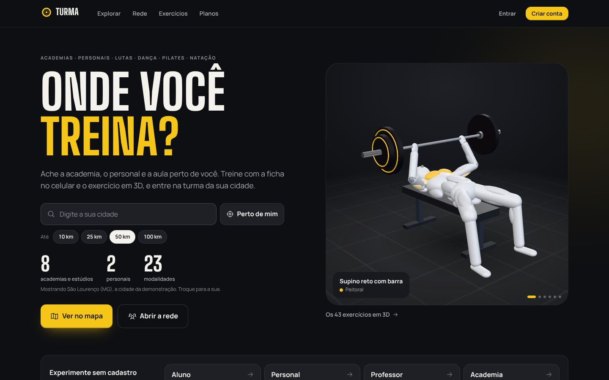
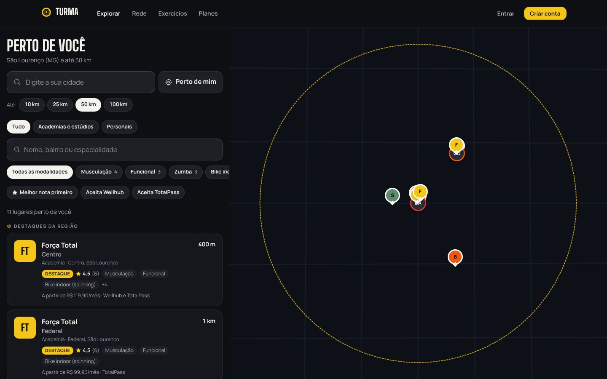
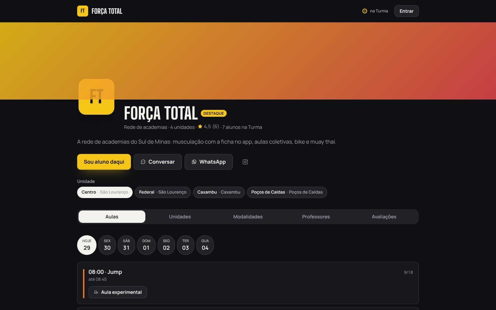
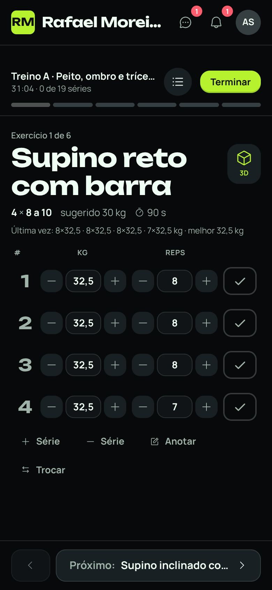
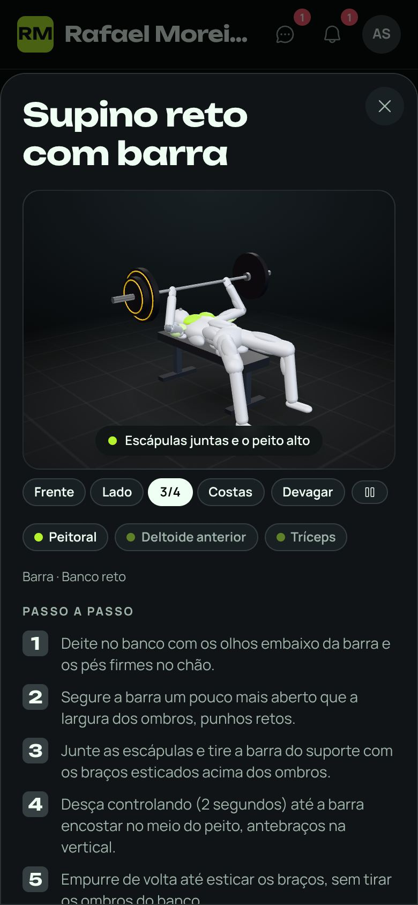
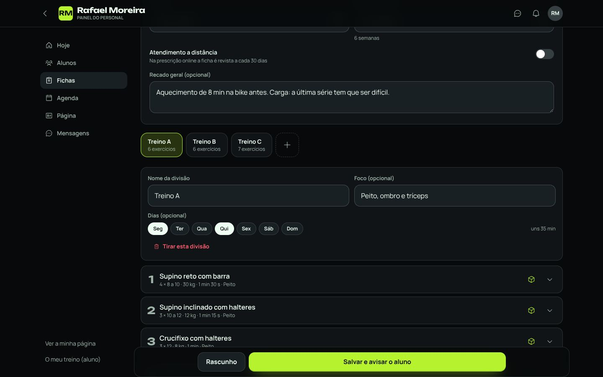
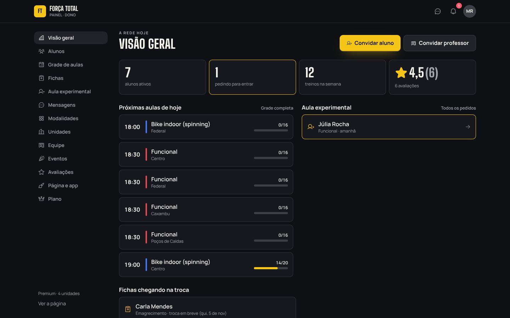
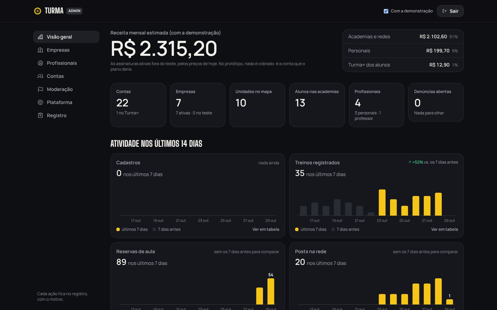

# Turma

A plataforma das academias, dos personais e da rede do treino. Num lugar só: a **academia** (ou a
rede de academias, o estúdio, o box, o CT de lutas, a escola de dança, a natação) com as unidades
no mapa, a grade das modalidades e o app com a marca dela; o **professor**, com uma conta só para
todos os lugares onde dá aula; o **personal trainer**, com os alunos, as fichas, a agenda, a página
e o app com a cara dele; e o **aluno**, que acha onde treinar na região dele (até 50 km), treina com
a ficha no celular e o exercício em 3D, guarda o histórico e as medidas, e entra na **rede do
treino** (posts, desafios, chat), com a academia e o professor marcados.

- Estudo de caso (mercado, fluxos, modalidades, o 3D, planos, riscos e as decisões):
  [`docs/estudo-de-caso.md`](docs/estudo-de-caso.md)
- O passo a passo do desenvolvimento, com as decisões de implementação:
  [`docs/desenvolvimento.md`](docs/desenvolvimento.md)
- Conteúdo para confirmar antes de publicar: [`conteudo.md`](conteudo.md)

Mesma base da Régua, do Prato Cheio e da Mão Dupla: **Vite + React 19 + TypeScript + Tailwind 4 +
three.js + Motion + Lenis + MapLibre**, publicado no **Netlify** com **Functions** e **Blobs** (sem
banco de dados para manter no protótipo).



## O produto

### A landing (`/`) e o mapa (`/explorar`)

A capa pergunta **"Onde você treina?"**: a cidade (ou o GPS) e o raio (10, 25, 50 ou 100 km), e os
números da região mudam na hora (academias e estúdios, personais, modalidades). Ao lado, o **boneco
3D** treinando, trocando de exercício. Logo abaixo, **"Experimente sem cadastro"**: entrar como
aluno, personal, professor ou academia numa conta pronta da demonstração. Depois, as **portas de
cadastro** (quero treinar, sou personal, dou aula numa academia, tenho uma academia ou rede), **como
funciona**, **"Monte o seu app"** (o nome, o estilo e a cor mudam o celular ao lado), os
**planos** em três abas (para você, para o personal, para a academia) e as perguntas frequentes.

O **Explorar** é o mapa da região com o círculo do raio e a lista: academias e estúdios, personais,
cada modalidade com a contagem, melhor nota primeiro, quem aceita Wellhub ou TotalPass e os
**destaques** (no máximo 3, só Premium e com nota 4 ou mais). Quem está em São Lourenço (MG) vê
Caxambu, que fica a 25 km, e não vê Poços de Caldas, a 161 km.



### As páginas públicas

- **A academia** (`/forca-total`): a capa, a logo e as cores dela; as abas **Aulas** (a grade do dia
  por unidade, com vagas, reserva, fila de espera, lugar marcado e a **aula experimental**),
  **Unidades** (o mapa com todas, horário, comodidades, preço), **Modalidades** (com as faixas das
  lutas), **Professores** e **Avaliações**; o "sou aluno daqui", o WhatsApp e os eventos. A página da
  empresa é sempre pública.
- **O personal** (`/rafael-moreira`): os números (alunos instruídos, fichas, treinos dos alunos,
  nota), onde atende, a agenda para marcar sessão, as avaliações e o **cartão para os stories**.
- **O professor** (`/diego-alves`): onde ele dá aula (a Força Total e o CT Tatame Sul) e os números.
- **A pessoa** (`/u/ana.souza`): o perfil, os posts e as faixas; público ou privado (muda quando
  quiser), e o privado só mostra para quem foi aprovado.
- **O convite** (`/convite/<código>`): o link (e o QR) que a academia, o personal ou o professor
  mandam; quem entra por ele já fica vinculado e o app ganha a cara de quem convidou.



### O aluno (`/app`)

O app veste a marca de quem o aluno escolheu (a academia, o personal); quem chega sozinho usa a da
plataforma. **Início** com o treino de hoje e a sequência; **Fichas** (a do personal, a da
academia e as próprias, com a **data de previsão** da troca e o aviso quando chega uma nova);
**Treinar**, o **treino ao vivo**: cada série com a carga e as repetições, o descanso com bipe e
vibração, o recorde na hora, e tudo guardado no aparelho (funciona sem internet e manda quando a
conexão volta); o **3D de cada exercício** com os músculos acesos na cor da marca, as vistas e o
passo a passo; **Histórico** (os lugares onde treinou, as academias, os professores, as avaliações
que fez e as que faltam), **Evolução** (carga, força estimada e volume por exercício), **Medidas**
(peso, gordura, circunferências e fotos, que o profissional só vê com a permissão do aluno),
**Agenda** (as sessões com o personal ou o professor), **Aulas** (as reservas, a fila e o
"cheguei"), **Desafios**, a **Rede**, as **Mensagens** e a **Conta** (o Turma+, a privacidade, a
cidade e o raio, os bloqueados). O catálogo dos 43 exercícios em 3D fica em `/exercicios`.

| | |
| --- | --- |
|  |  |

### O profissional (`/pro`)

O mesmo painel para o personal e para o professor. **Hoje** (as sessões, as fichas chegando na
troca, quem sumiu, os números), **Alunos** (os do personal e os de cada academia onde dá aula),
**Fichas** (as dos alunos, os **modelos** para dar o mesmo treino a outro aluno sem montar de novo e
os exercícios próprios com vídeo), o **montador** com o catálogo 3D (divisões, séries, carga,
descanso, a técnica e o recado; "o mesmo treino está com Ana e Bruna"; a próxima fase arquiva a
anterior e avisa o aluno), a **Agenda** (os horários por dia da semana, os bloqueios e as sessões) e
a **Página** (os dados, onde atende, o app com a marca, o plano e as avaliações).



### A academia e a rede (`/painel/<endereço>`)

Cada papel vê o que é dele: o **dono** e o **gerente** configuram tudo, a **recepção** cuida dos
alunos, da aula experimental e da caixa de mensagens, e o **professor** monta as fichas, gradua e
marca a presença. **Visão geral** (os alunos, quem pediu para entrar, os treinos da semana, as
próximas aulas com a ocupação, os pedidos de aula experimental, as fichas vencendo); **Alunos**
(aprovar, filtrar por unidade e por quem sumiu; no aluno, a unidade, o professor responsável, as
modalidades e a **graduação**); **Grade de aulas** por unidade (vagas, reserva, lugar marcado,
nível, público e a presença do dia com a fila); **Fichas**; **Aula experimental**; **Modalidades**
(as 42 do catálogo em 10 famílias, o que vem no plano e o que é à parte, os níveis, os públicos e o
**editor de faixas**); **Unidades** (o pino no mapa, o horário de cada dia, as comodidades, Wellhub
e TotalPass, a mensalidade); **Equipe** (papéis, unidades, convite e a agenda dos professores);
**Eventos e desafios oficiais** (Premium); **Avaliações** (com a resposta da academia); **Página e
app** (o texto, o cartão e a marca: estilo, cor, fonte, logo, capa e o nome no ícone); e o
**Plano** (por unidade, com o desconto de rede).



### O admin (`/admin`)

Com a senha do `ADMIN_PASSWORD` (e o código do autenticador, se o `ADMIN_TOTP` estiver ligado). A
**visão geral** com a receita mensal estimada, os números da plataforma e a atividade dos últimos
14 dias; **empresas**, **profissionais** e **contas** com a busca, os filtros e as ações (suspender,
reativar, trocar o plano, estender o teste, bloquear, dar o Turma+); a **moderação** (liberar,
ocultar ou apagar o post ou o comentário denunciado); a **plataforma** (os preços, os limites, o
desconto da rede, os dias de teste, o raio, o cadastro aberto e o aviso no topo); e o **registro**
de tudo, mês a mês. O que mexe com alguém pede o motivo. A chave **"com a demonstração"** mostra ou
esconde os números das contas de exemplo, e dá para **recriar** ou **apagar** a demonstração.



## Rodando

```bash
npm install
npm run dev        # http://localhost:5173
npm run build      # gera dist/
npm run typecheck
npm test           # 60 testes: regras, conta, academia, aulas, fichas, rede, demonstração, admin e o boneco
```

No `npm run dev` as Netlify Functions e o Netlify Blobs são simulados pelo `@netlify/vite-plugin`
(os dados ficam na pasta `.netlify/`, fora do git). Crie um arquivo `.env`:

```bash
ADMIN_PASSWORD=uma-senha-de-teste
SESSION_SECRET=um-texto-longo-e-aleatorio
# opcionais
ADMIN_TOTP=JBSWY3DPEHPK3PXP         # segundo fator do admin (base32, o mesmo do app autenticador)
TURMA_SEM_DEMONSTRACAO=1            # sobe sem a demonstração
```

## A demonstração

No primeiro acesso o servidor cria **São Lourenço (MG) e região**: a **Força Total** (a rede, com
quatro unidades: Centro e Federal em São Lourenço, Caxambu e Poços de Caldas, essa a 161 km, para
mostrar o raio), o **CT Tatame Sul** (lutas, com as faixas), o **Studio Equilíbrio** (pilates com o
aparelho marcado), a **Escola de Dança Compasso**, a **Academia Águas Claras** (natação), o **Box
Serra Cross** e a **Academia Vértice** (em Pouso Alegre, a 92 km: aparece com o raio de 100 km);
os personais **Rafael Moreira** (São Lourenço), **Camila Duarte** (Caxambu) e **Patrícia Lima**
(Poços); o professor **Diego Alves**, que dá aula na Força Total e no CT; e os alunos, com as
fichas, os treinos, as medidas, as reservas, os posts, os desafios e as conversas.

Para experimentar sem cadastro ("Experimente sem cadastro", na landing e no login):

- **Aluno:** a Ana, com a ficha do Rafa, o treino de hoje, a rede e as mensagens. **Cada visita
  ganha a sua cópia da Ana**: o que ela faz não aparece para as outras visitas, e **some em um dia**.
- **Personal:** o Rafa, com os alunos, as fichas, os modelos e a agenda.
- **Professor:** o Diego, com as duas academias.
- **Academia:** a Marta, dona da Força Total, no painel da rede.

Endereços para testar: `/`, `/explorar`, `/rede`, `/exercicios`, `/forca-total`, `/ct-tatame-sul`,
`/studio-equilibrio`, `/rafael-moreira`, `/diego-alves`, `/u/ana.souza`, `/app`, `/pro`,
`/painel/forca-total` e `/admin`. A demonstração tem versão e se recria a cada três dias (o que é
de verdade não é tocado); no admin, dá para recriar na hora ou **apagar** para o lançamento (a
landing deixa de mostrar o "experimente").

## Publicando no Netlify

O `netlify.toml` já está pronto (build `npm run build`, pasta `dist`, Node 22, funções em
`netlify/functions`, `/admin`, `/painel` e `/pro` fora do Google). É só conectar o repositório no
Netlify e, em **Site configuration → Environment variables**, criar:

- `ADMIN_PASSWORD` (obrigatório para usar o `/admin`): uma senha forte.
- `SESSION_SECRET` (recomendado): um texto longo e aleatório, que assina o login. Trocar essa
  variável desconecta todo mundo.
- `ADMIN_TOTP` (opcional): o segredo em base32 do aplicativo autenticador; com ele, o admin pede
  também o código de 6 números.
- `TURMA_SEM_DEMONSTRACAO` (opcional): para subir sem a demonstração.

Depois, um deploy novo (**Deploys → Trigger deploy**). Os dados ficam no **Netlify Blobs** do
próprio site (o armazém `turma`).

## Como funciona

```
navegador                                  Netlify Functions                         Netlify Blobs
─────────                                  ─────────────────                         ─────────────
landing, explorar, páginas, app,  ──────▶  sessao     login, cadastro, academia ──▶  contas/…
pro, painel, admin                         explorar   o mapa da região               empresas/…
  src/shared/ (as mesmas regras)           pagina     as páginas públicas            profissionais/…
  o treino ao vivo no aparelho             aluno, ficha, treino, medidas      ──▶    fichas/…, treinos/…
  o 3D em three.js, sem arquivos           aulas, agenda, avaliacao, desafio         aulas/… (a folha do dia)
                                           rede, conversa, avisos, midia      ──▶    rede/…, conversas/…
                                           pro, painel, plataforma, admin            plataforma/…
                                           manifesto (o app de cada marca)
```

- **Uma regra só, nos dois lados.** A data de previsão da ficha, a rotação das divisões, a força
  estimada, os recordes, a sequência, a vaga da aula e a fila, os horários da agenda, as faixas, os
  limites dos planos e a região estão em `src/shared/`: o navegador mostra, o servidor decide.
- **A vaga da aula e o horário da agenda** ficam numa folha por unidade por dia (e por profissional
  por dia), gravada com **escrita condicional** (etag do Blobs): duas pessoas na última vaga, uma
  entra e a outra vai para a fila (tem teste). Quem cancela libera a vaga e o primeiro da fila
  entra sozinho, com o aviso.
- **O treino ao vivo** é guardado no aparelho a cada toque e enviado no fim; sem internet, entra
  numa fila e vai quando a conexão volta. O servidor ignora o mesmo treino mandado duas vezes e
  recusa treino de menos de um minuto.
- **O app com a marca** de cada academia e de cada personal: o estilo, a cor, a fonte (a própria,
  no Premium), a logo e a capa viram variáveis de CSS por cima das da plataforma, e o `manifesto`
  dá o ícone, o nome e a cor para quem adiciona o app à tela inicial. Sem loja.
- **O 3D** é um boneco feito em código (three.js, sem arquivos de modelo), com o equipamento de cada
  exercício, os músculos acesos na cor da marca e a câmera que enquadra o movimento. Só carrega
  quando aparece.
- **A região** é a distância calculada no servidor sobre o índice das unidades e dos profissionais;
  o destaque é do Premium, com nota 4 ou mais, no máximo 3 por vez.
- **A rede e o chat:** o servidor recusa telefone e link no texto, três denúncias escondem até a
  revisão, o perfil privado só mostra para quem foi aprovado e o bloqueio some com a pessoa. O chat
  entre alunos só abre quando os dois se seguem; com o profissional e com a academia, sempre.
- **As medidas são do aluno:** o profissional só vê (e lança a avaliação física) com o consentimento,
  e as fotos de evolução são privadas.

**Segurança e limites:** senha com scrypt e sessão num cookie assinado (`HttpOnly`, 60 dias); 8
senhas erradas seguidas travam aquele login (e o `/admin`) por 15 minutos; a sessão do admin dura
12 horas. Por janela de tempo, entre outros: 6 cadastros por hora por endereço, 30 treinos e 20
posts por hora, 60 comentários e 90 mensagens por hora, 15 denúncias por hora, 6 pedidos de aula
experimental e 20 avaliações por dia por conta. As funções só aceitam JSON da própria origem.

**No protótipo, nada de dinheiro se move:** as assinaturas (da academia, do personal e o Turma+) são
simuladas e mudam na hora, e as telas dizem isso.

## Onde editar

| O quê | Onde |
| --- | --- |
| Preços, limites do grátis e do Básico, desconto da rede, dias de teste, raio padrão, cadastro aberto, aviso no topo | **Admin** (`/admin` → Plataforma); o padrão em `src/shared/planos.ts` |
| O que cada plano inclui (o texto da landing e dos painéis) | `src/shared/planos.ts` (`RECURSOS_ALUNO`, `RECURSOS_PERSONAL`, `RECURSOS_EMPRESA`) |
| As 42 modalidades e as 10 famílias | `src/shared/modalidades.ts` |
| As faixas de cada luta (o padrão; cada academia ajusta no painel) | `src/shared/graduacao.ts` |
| Os 43 exercícios (músculos, equipamento, passo a passo, pontos de atenção) | `src/shared/exercicios.ts` |
| O movimento de cada exercício no 3D | `src/components/three/boneco/` (e o laboratório em `/lab`) |
| Os estilos do app com a marca (cores, fontes, raios) | `src/shared/temas.ts` |
| Os motivos da avaliação e da denúncia | `src/shared/avaliacao.ts` e `netlify/lib/rede.ts` |
| As cores, as fontes e os componentes da plataforma | `src/index.css` |
| Os textos da landing | `src/components/landing/` (cada seção num arquivo) e `src/paginas/Landing.tsx` |
| A demonstração | `netlify/lib/semente.ts` (as academias, os profissionais, os alunos e o que eles fizeram) e `netlify/lib/visitas.ts` |

## Desempenho

- **Cada tela carrega à parte**: quem abre o app da academia não baixa o painel, a landing nem o
  admin. O three.js só vem quando o boneco vai aparecer, e o MapLibre só nas telas com mapa; a
  lista das cidades do IBGE só quando alguém digita a cidade.
- **Uma cena 3D por vez**, que só desenha enquanto está na tela; com **movimento reduzido**
  (preferência do sistema), o boneco fica parado na pose do meio do movimento.
- **O que já foi lido fica num cache da sessão**: voltar para uma tela mostra na hora o que ela
  tinha e atualiza por trás. No admin, ao trocar o filtro, a leitura anterior fica na tela até a
  nova chegar.

## O que falta para produção

- **A cobrança de verdade** das assinaturas (Pix e cartão, a nota fiscal) e o que acontece com quem
  atrasa (hoje o admin suspende à mão).
- **O login pelo código** por SMS ou WhatsApp (hoje é e-mail ou celular e senha) e a recuperação de
  senha.
- **As notificações** fora do app (push, WhatsApp) para a ficha nova, a vaga que abriu na fila e a
  mensagem; hoje é o sino dentro do app.
- **Tempo real** no chat e na fila por conexão aberta, no lugar da consulta a cada poucos segundos.
- **Um banco de dados com mapa** (Postgres com PostGIS) quando o volume crescer; o Blobs aguenta o
  protótipo e o começo (seção 23.1 do estudo).
- **Wellhub e TotalPass** (a integração com o check-in deles) e a **nutrição** com o prato em 3D, que
  é a fase 2 (seção 21 do estudo).
- **Os termos de uso e a política de privacidade** (LGPD: as medidas e as fotos são dado sensível) e
  a revisão do texto dos exercícios por um profissional de educação física com CREF.
- **Os mapas:** o OpenFreeMap é grátis e sem garantia; para operar, um provedor com contrato.

## Estrutura

```
src/
  paginas/      landing, explorar, exercícios, conta (entrar, cadastro, começar como academia ou
                personal), públicas (a página da academia e do profissional, o perfil, o convite),
                aluno (início, fichas, treinar, histórico, evolução, medidas, agenda, aulas,
                desafios, conta, avisos), rede, mensagens
  pro/          o painel do profissional: hoje, alunos, fichas e o montador, agenda, página
  painel/       o painel da academia e da rede: visão geral, alunos, grade, fichas, aula
                experimental, modalidades, unidades, equipe, eventos, avaliações, página e app, plano
  admin/        o admin da plataforma (/admin), carregado à parte
  lab/          o laboratório do 3D (/lab): cada exercício em câmera lenta
  components/
    landing/    a capa, as portas, como funciona, monte o seu app, planos, perguntas
    three/      o boneco 3D e o equipamento
    ficha/ treino/ graficos/ medidas/ agenda/ rede/ marca/ mapa/ perfil/ layout/ ui/ ...
  lib/          chamadas à API, sessão, rotas, dados (cache), o treino no aparelho, tema
  shared/       o que o navegador e o servidor usam: tipos, ficha, treino, aulas, agenda, graduação,
                modalidades, exercícios, planos, região, temas, textos, horários
netlify/
  functions/    sessao, explorar, pagina, aluno, ficha, treino, medidas, aulas, agenda, avaliacao,
                desafio, rede, conversa, avisos, midia, pro, painel, plataforma, admin, manifesto
  lib/          Blobs (com etag), HTTP e limites, login, contas, empresas, profissionais, vínculos,
                fichas, treinos, grade, sessões, rede, conversas, admin, estatísticas, a demonstração
test/           os testes (node --test, com o Blobs em memória e as funções rodando de verdade)
docs/           estudo de caso, desenvolvimento e imagens
```
