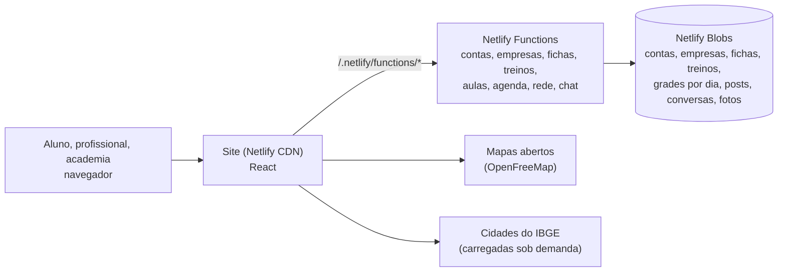

# Estudo de caso: Turma, a plataforma das academias, dos personais e da rede do treino

> **Status:** conceito e protótipo. O que está descrito como "no protótipo" está implementado (veja o
> [README](../README.md)); o resto é proposta.
> **Data:** outubro de 2026.
> **Nome:** **Turma** (provisório). "Turma" é a turma da aula (a turma das 19h do muay thai, a turma do
> pilates) e é a galera que treina junto, que é o que a rede social entrega. Trocar o nome, o domínio e
> o e-mail é um arquivo só (`src/data/marca.ts`). Alternativas na seção 26.

---

## 1. Resumo (TL;DR)

**Sistema de academia sozinho não é diferencial.** Tecnofit, Next Fit, EVO e dezenas de outros já
cuidam de matrícula, cobrança e catraca; MFIT, Trainerize e TrueCoach já entregam ficha para o
personal; Hevy e Strong registram treino; e o GymRats virou a febre da rede social do treino no
Brasil. Cada um resolve um pedaço. Ninguém junta as quatro pontas **e** mostra tudo no mapa da
cidade de quem quer treinar. A Turma ganha em quatro coisas:

1. **Uma plataforma, quatro portas.** A academia (ou a rede de academias, o estúdio, o CT de lutas),
   o professor, o personal trainer e o aluno usam o mesmo app, cada um com o seu papel. O professor
   que trabalha em três lugares tem uma conta só; o aluno que treina na academia e tem personal vê as
   duas fichas no mesmo lugar.
2. **O app com a cara de quem paga.** A academia e o personal montam o app deles (estilo, cor, fonte,
   logo e nome), que o aluno instala na tela inicial sem loja. Até o boneco 3D dos exercícios acende
   os músculos na cor da marca. A plataforma tem identidade neutra por fora; por dentro, cada um
   tem a sua (a mesma ideia da Régua e da Mão Dupla).
3. **O boneco 3D que mostra o movimento certo.** Cada exercício do catálogo tem um boneco em 3D
   fazendo o movimento completo, com o equipamento, os músculos que trabalham acesos e os pontos de
   atenção ("desça a barra até o meio do peito"). O professor vê enquanto monta a ficha; o aluno vê
   na hora de treinar. É o que vende com os olhos na landing.
4. **A rede do treino que não é da concorrência.** O GymRats foi comprado pela Smart Fit em 2026
   (seção 3). A academia independente, o estúdio e o personal precisam de uma rede deles: aqui o
   aluno posta o "treino pago", marca a academia e o professor, entra em desafios e a comunidade
   fica **na região dele** (no máximo 50 km, como pedido), com o mapa das academias, dos personais
   e das modalidades.

Por baixo, o básico bem feito: **ficha de treino com data de previsão** (o aluno é avisado quando
chega uma ficha nova e quando ela vence), **treino ao vivo** (exercício, carga, repetições,
descanso, sem depender de internet), **medidas** do próprio aluno, **avaliações** com perfil
público compartilhável, **agenda** entre personal e aluno, **modalidades com grade, vagas, aula
experimental e faixas** (lutas, dança, aquáticas, corpo e mente...) e **chat** entre todo mundo.

**Planos:** todos por assinatura mensal, cada público com um básico e um premium. O premium dá
**destaque** na região (academia e personal) e, para o aluno, libera o que não pode ser de graça
(fichas próprias sem limite, histórico completo, fotos de evolução e, na fase 2, a **nutrição com o
prato montado em 3D**). As contas estão na seção 20.

---

## 2. O que a ideia pede

| # | Requisito | Viável? | No protótipo |
|---|-----------|---------|--------------|
| R1 | Academia (ou rede de academias) se cadastra como empresa | ✅ | ✅ |
| R2 | A rede cadastra as unidades pela localização, e elas aparecem num mapa | ✅ MapLibre + mapa aberto | ✅ |
| R3 | A academia cadastra professores e alunos | ✅ convite por link | ✅ |
| R4 | Cada empresa e cada personal personaliza o app (logo, cores, texto) | ✅ temas por variáveis CSS + PWA por empresa | ✅ |
| R5 | Professor monta a ficha de treino escolhendo exercícios do catálogo | ✅ | ✅ |
| R6 | Aluno é notificado da ficha nova; a ficha tem data de previsão | ✅ (aviso no app; push na fase 2) | ✅ |
| R7 | Acompanhamento do treino na hora: exercício, peso, repetições, descanso | ✅ | ✅ (funciona sem internet) |
| R8 | Aluno avalia o professor; perfil do professor com números, compartilhável | ✅ | ✅ (com o cartão para o Instagram) |
| R9 | Personal trainer assina a plataforma, cadastra alunos e fichas, com app com a cara dele | ✅ | ✅ |
| R10 | Personal vê treinos iguais e reaproveita para outro aluno | ✅ modelos e "usar em outro aluno" | ✅ |
| R11 | Agenda entre personal e aluno (dia da semana, horário) | ✅ | ✅ |
| R12 | Agenda entre professor e aluno da academia, como opção | ✅ | ✅ (a academia liga ou desliga) |
| R13 | Outras modalidades (dança, luta...) com cadastro rico: **muita importância** | ✅ pesquisa na seção 8 | ✅ grade, vagas, reserva, lista de espera, aula experimental, faixas, lugar marcado |
| R14 | Usuário entra avulso (pela plataforma) ou pelo link de uma academia/personal/professor | ✅ | ✅ |
| R15 | Filtrar por região (São Lourenço não vê Poços de Caldas; ~50 km) | ✅ 5.571 cidades do IBGE + GPS | ✅ raio de 10, 25, 50 ou 100 km |
| R16 | Professor pode trabalhar em vários lugares; o link dele mostra onde | ✅ | ✅ |
| R17 | Perfil público opcional (professor, personal e aluno), mutável a qualquer momento; empresa sempre pública | ✅ | ✅ |
| R18 | Aluno guarda lugares onde treinou, fichas, professores, avaliações | ✅ | ✅ |
| R19 | Aluno controla as próprias medidas e o peso | ✅ (dado sensível na LGPD, seção 12) | ✅ |
| R20 | Rede social como o GymRats: interagir, marcar academias e profissionais | ✅ | ✅ "treino pago", desafios, curtir, comentar, seguir |
| R21 | Chat usuário × profissional, usuário × empresa, empresa × professor (e entre usuários) | ✅ | ✅ com as regras da seção 17 |
| R22 | Exibição 3D de cada exercício (o boneco fazendo o supino reto do jeito certo) | ✅ seção 11 | ✅ 43 exercícios com boneco 3D |
| R23 | Landing comercial com duas camadas (usuário pela localização; cadastro de todos) | ✅ | ✅ |
| R24 | Planos por assinatura mensal, um básico e um premium de cada | ✅ | ✅ (sem cobrança, como nos outros protótipos) |
| R25 | Destaque na plataforma para quem é premium (empresa, personal, até o usuário) | ✅ regras na seção 20.2 | ✅ |
| R26 | Limites coerentes entre grátis e premium (não liberar tudo) | ✅ | ✅ |
| R27 | Nutrição, nutricionista e o prato montado em 3D | ✅ | 🔜 fase 2 (escopo na seção 21) |
| R28 | Admin da plataforma | ✅ | ✅ |

---

## 3. O mercado

| Quem | O que faz | Preço (o que achei) | O que não faz |
|---|---|---|---|
| **Tecnofit** | Gestão da academia: cobrança, app do aluno, CRM, financeiro, site de vendas e app com a marca da academia nas lojas | De R$ 139 a R$ 1.129/mês conforme o número de alunos (dado de 2021, provavelmente mudou) | Não tem rede social nem vitrine regional; o personal autônomo não é o foco |
| **Next Fit** | ERP fitness (captou R$ 50 milhões em série A) | Tabela fixa no site (não abriu daqui) | Mesmo recorte: gestão, não comunidade |
| **EVO (W12), Pacto** | Sistemas das grandes redes | Sob consulta | Pesados para a academia de bairro |
| **MFIT Personal** | Anamnese, avaliação física, prescrição e cobrança para o personal | Teste grátis sem cartão; preço não apareceu nas buscas | Só o personal; sem academia, sem rede |
| **TrueCoach** | Ficha e acompanhamento para treinadores (EUA) | US$ 29,98 (até 5 alunos), US$ 69,98 (até 20), US$ 164,98 (até 50) por mês | Cobra pelo número de alunos ativos |
| **Trainerize** | O mesmo, com app com a marca | ~US$ 10 (2 alunos) a US$ 135 (~50) por mês, segundo comparativos | Idem |
| **Hevy** | Registro de treino para quem treina sozinho | Grátis com limite (4 rotinas, 7 exercícios próprios, 3 meses de gráfico); Pro US$ 2,99/mês | Não liga o aluno à academia nem ao personal |
| **Muscle & Motion** | 1.200+ exercícios em 3D com os músculos acesos | Assinatura | É uma biblioteca para estudar, não a ficha do aluno |
| **GymRats** | Rede social do treino: check-in com foto, desafios com ranking | Grátis + Pro | **Desde 2026 é da Smart Fit** (acordo de agosto; notícias falam em R$ 11 milhões), e o Pro virou benefício dos alunos da rede |
| **Wellhub e TotalPass** | Benefício corporativo que leva o aluno a várias academias | Pago pela empresa do aluno | A academia é parceira, não dona do aluno |

**O que isso diz:**

- **O GymRats foi o sinal e a Smart Fit leu primeiro.** A rede social do treino prende o aluno
  (93% das visitas ao site do GymRats vêm do Brasil, segundo a Similarweb em maio de 2025). A maior
  rede do país comprou a dela. A academia de bairro, o estúdio, o CT de lutas e o personal ficaram
  sem uma rede que seja deles; é a porta da Turma.
- **Ninguém mostra a cidade.** Quem quer começar a treinar procura "academia perto de mim" no Google.
  Não existe um lugar que mostre, num raio de 50 km, as academias, os estúdios, os CTs, os personais
  e as modalidades com horário, vaga e preço a partir de quanto.
- **O personal paga por aluno lá fora.** TrueCoach e Trainerize cobram por faixa de alunos ativos.
  No Brasil a sessão de personal custa de R$ 60 a R$ 250 (a maioria entre R$ 86 e R$ 150); um aluno
  já paga a assinatura. Plano por faixa (até 15 alunos no básico) é o modelo que o mercado aceita.
- **O mercado cresce.** O Panorama Setorial Fitness Brasil 2025 conta 62.718 centros de atividade
  física (eram 22.581 em 2015) e projeta mais de 70 mil até 2027; a HFA coloca o Brasil em 3º no
  mundo em número de academias. Minas Gerais é o segundo maior mercado do país. Os estúdios
  boutique (pilates, cross, lutas) crescem mais rápido que a academia tradicional.

---

## 4. Quem usa

| | **Empresa** (academia, rede, estúdio, CT) | **Personal** | **Professor** (da academia) | **Aluno** |
|---|---|---|---|---|
| Quer | Aluno que fica (retenção), aluno novo da região, parecer grande, organizar as aulas | Agenda cheia, parecer profissional, parar de mandar ficha em PDF no WhatsApp, cliente novo | Montar ficha rápido, ser reconhecido, levar os alunos quando muda de academia | Saber o que fazer na academia, ver a evolução, treinar com a turma, achar lugar perto |
| Objeção | "Já tenho sistema", "aluno não baixa app", "é mais um custo" | "Já uso planilha/WhatsApp", "é caro", "dá trabalho" | "Mais um app" | "Não sei se é bom", "não quero criar conta", "não quero expor meu peso" |
| Resposta | Não substitui a catraca nem a cobrança: é o **app do aluno com a sua marca**, a vitrine no mapa e a comunidade; aluno instala pelo link, sem loja | Página e app com a cara dele em 2 minutos, ficha com 3D, agenda, e o cartão com os números para o Instagram | Uma conta para todas as academias; o perfil e as avaliações são dele | Ver sem conta (mapa, perfis, rede); medidas sempre privadas; perfil público só se quiser |
| Onde chega | Landing (venda), indicação, o aluno que já usa | Landing, colega personal, o aluno que posta | Convite da academia | Landing (camada do usuário), link da academia ou do personal, post na rede, o mapa |
| Momento "uau" | Digita o nome e a cor e vê o app dele no celular; as unidades acendem no mapa | O boneco 3D fazendo o exercício que ele acabou de pôr na ficha, na cor da marca dele | O perfil com "120 alunos instruídos ★ 4,9" | "Treino pago ✅" com o resumo do treino e a turma curtindo |

---

## 5. Fluxos

### 5.1 Aluno avulso (pela landing)

```
Landing (camada do usuário)
  └ "Onde você treina?"  → usar minha localização (GPS) ou digitar a cidade (5.571 do IBGE)
      └ na hora: "38 academias, 12 personais e 21 modalidades em até 50 km"
          └ Explorar: mapa + lista (academias, estúdios, CTs, personais), filtros por modalidade,
            distância, nota, "aceita Wellhub/TotalPass", "aberto agora"
              └ Página da academia → grade das modalidades → "Agendar aula experimental"
              └ Página do personal → "Quero treinar com você" → conversa
          └ Rede: "Perto de você" já filtrada pela cidade escolhida (sem conta, só ver)
  └ Curtir, comentar, postar, conversar, reservar aula, montar a própria ficha: pede conta
     (o cadastro leva a cidade escolhida)
```

### 5.2 Aluno pelo link (da academia, do personal ou do professor)

```
A academia (ou o personal) cadastra "Ana, (35) 9...." → link de convite → manda no WhatsApp
  └ Ana abre /convite/XXXX: o app já vem com a cara da academia (logo, cor, nome)
      └ cria a conta (ou entra) → aceita → vinculada
          └ a ficha que o professor montou aparece com o aviso "Ficha nova: Hipertrofia A/B/C"
          └ "Adicionar à tela inicial": vira o app da Força Total, com o ícone dela
```

O caminho de volta também existe: na página da academia, o aluno toca em **"Sou aluno daqui"** e a
academia aprova no painel. Quem entra pelo link de um professor vê **onde ele dá aula** (as
academias e as unidades no mapa) e escolhe onde treinar.

### 5.3 Academia ou rede de academias

```
Landing → "Tenho uma academia" → Monte o seu app (nome, tipo, cor, logo: o celular ao lado muda na hora)
  └ cadastro curto (nome, e-mail ou celular, senha) → 30 dias com tudo liberado
      └ Primeiros passos no painel:
          1. Unidades: endereço e o pino no mapa (uma ou várias; a rede cadastra todas)
          2. Modalidades e grade: musculação, lutas, dança... dias, horários, vagas, professor
          3. Professores: convite por link
          4. Alunos: convite por link ou planilha (fase 2)
          5. Compartilhar: link, QR para o balcão e o texto para a bio
```

### 5.4 Professor convidado

O professor recebe o link da academia, cria a conta (ou usa a que já tem) e entra na equipe. Se
já dá aula em outra academia da plataforma, **é a mesma conta**: o painel mostra os alunos de cada
lugar separados, e o perfil público mostra os lugares. O professor não paga; quem paga é a academia.
Se ele também atende por conta própria, assina o plano de personal na mesma conta.

### 5.5 Personal trainer

```
Landing → "Sou personal" → Monte o seu app (nome, especialidades, cor, foto)
  └ cadastro → 30 dias com tudo liberado
      └ Onde atendo: as academias da plataforma (no mapa), domicílio, parque, online; a cidade e o raio
      └ Alunos: convite por link; ficha (do zero, de um modelo ou copiada de outro aluno)
      └ Agenda: horários livres na semana, sessões fixas (seg/qua/sex 7h), o aluno marca e desmarca
      └ Perfil público e o cartão com os números para o Instagram
```

---

## 6. Contas, papéis e perfil público

- **Uma conta por pessoa**, entrando com e-mail **ou** celular e a senha. A conta pode ser aluno
  (todo mundo é), profissional (personal, professor ou os dois) e membro de empresas (dono,
  gerente, recepção ou professor). O menu mostra os painéis de cada papel.
- **Perfil público** (pedido explícito):

| Quem | Padrão | Pode mudar | Público mostra | Privado mostra |
|---|---|---|---|---|
| Empresa | Sempre público | **Não** | Tudo (é a vitrine) | — |
| Personal | Público | Sim, a qualquer hora | Página com a marca, números, avaliações, locais, posts | Só para os alunos dele |
| Professor | Pergunta no cadastro (sugere público) | Sim | Números, avaliações, onde dá aula | Só para os alunos e a equipe |
| Aluno | Privado | Sim | Posts, desafios, lugares onde treina, faixas | Nome e foto; posts só para quem ele aprovar |

- **Perfil privado funciona como no Instagram:** seguir vira pedido, e os posts só aparecem para os
  seguidores aprovados. Ninguém além da própria pessoa vê as medidas, em nenhum dos dois modos (seção
  12). O profissional fora do ar some do mapa e da busca, mas continua atendendo os alunos dele.

---

## 7. A academia e a rede de academias

- **Tipos:** academia, rede de academias, estúdio (pilates, funcional), box de cross, CT de lutas,
  escola de dança, academia aquática. O tipo muda o texto e os ícones; as funções são as mesmas.
- **Unidades:** nome, endereço, bairro, cidade (uma das 5.571), o pino no mapa, WhatsApp, horário de
  funcionamento por dia, comodidades (estacionamento, vestiário, ar-condicionado, acessibilidade,
  espaço kids...), "aceita Wellhub/TotalPass" (informativo) e o preço **a partir de** (a mensalidade
  é negócio da academia; a Turma só mostra). A rede cadastra todas as unidades e cada uma aparece no
  mapa por conta própria.
- **Equipe:** dono, gerente, recepção (responde o chat da empresa) e professores, cada um nas
  unidades onde trabalha.
- **Alunos:** convite, aprovação de quem pede, unidade, modalidades, faixa (nas lutas), ficha atual,
  última vez que treinou e a **frequência** (quem sumiu há 10 dias aparece em vermelho: é o aluno que
  a academia ainda pode recuperar).
- **Painel:** visão geral (alunos ativos, treinos na semana, ocupação das aulas, fichas vencendo,
  aulas experimentais pedidas, nota), unidades, modalidades e grade, equipe, alunos, fichas,
  avaliações, mensagens, aparência (o app), desafios e eventos, plano.

---

## 8. Modalidades (a pesquisa pedida)

Musculação é a base, mas o que diferencia a academia e o que traz aluno novo são as outras
modalidades. Um levantamento citado pelo Sebrae PR põe o **funcional** à frente (74% dos
praticantes), seguido da **musculação** (68%) e do **alongamento** (57%); a procura por lutas mais
que dobrou num levantamento noticiado em 2018 (+109%), e os estúdios boutique (pilates, cross,
lutas) são o segmento que mais cresce. Cada família de modalidade tem uma necessidade própria, e o cadastro
precisa dar conta delas:

| Família | Exemplos | O que precisa além da grade |
|---|---|---|
| **Musculação** | Musculação, treino assistido | Ficha de treino (seção 9); sem reserva |
| **Funcional e cross** | Funcional, cross training, HIIT, circuito, LPO, calistenia | **Vagas** por aula, o treino do dia no mural da aula |
| **Aulas coletivas** | Jump, step, GAP, localizada, abdominal, zumba, ritmos, FitDance | Vagas; aula livre ou com reserva |
| **Bike** | Spinning, bike indoor | **Lugar marcado** (a bike 1 a 30), reserva com antecedência |
| **Corpo e mente** | Pilates de solo e de aparelhos, yoga, alongamento, meditação | Turmas pequenas (3 a 6 no aparelho), reserva obrigatória, **lugar marcado** (o aparelho) |
| **Lutas** | Jiu-jitsu, muay thai, boxe, kickboxing, judô, karatê, taekwondo, capoeira, MMA, krav maga | **Graduação** (faixas e graus, com histórico), turmas por idade (kids, juvenil, adulto) e nível, presença |
| **Dança** | Ballet, jazz, dança de salão, forró, zouk, hip hop, dança do ventre, K-pop | Nível (iniciação → avançado), turmas por idade, **eventos** (festival, apresentação) |
| **Aquáticas** | Natação infantil e adulto, hidroginástica, hidro para gestantes | **Nível** (adaptação, iniciante, intermediário...), vagas por raia, idade |
| **Corrida e ar livre** | Assessoria de corrida, treino no parque, trilha | Ponto de encontro (no mapa), sem estrutura física |
| **Públicos especiais** | Kids, melhor idade, gestantes, reabilitação | Faixa etária na turma, avisos (atestado) |

**No protótipo:**

- **Catálogo de 42 modalidades** em 10 famílias (`src/shared/modalidades.ts`). A academia liga as que
  oferece, escreve a descrição dela, o nível e o público, e diz se a modalidade está inclusa no plano
  ou é à parte (com o preço a partir de).
- **Grade por unidade:** cada aula tem dia da semana, horário, duração, sala (tatame, piscina, sala
  2), professor, vagas, nível, público e se pede **reserva**. O aluno reserva, cancela até o prazo, e
  entra na **lista de espera** quando lota; quando alguém cancela, o primeiro da fila entra sozinho e
  é avisado. Duas pessoas reservando a última vaga ao mesmo tempo: uma consegue e a outra vai para a
  fila (escrita condicional, como a agenda da Régua).
- **Lugar marcado** (bike e pilates): o aluno escolhe a bike 7 ou o reformer 2 ao reservar.
- **Aula experimental:** o visitante (com conta) pede pela página da academia, escolhe a aula na
  grade, e o pedido cai no painel da academia como **contato a responder**, com a conversa aberta. É o
  argumento de venda direto: a Turma traz aluno novo.
- **Graduação:** o jiu-jitsu (adulto e kids, com os graus), o judô, o karatê, o taekwondo, o muay
  thai e a capoeira já vêm com as faixas; a academia pode ajustar a lista. O professor gradua o aluno
  no painel, fica o histórico (data e quem graduou) e, se o aluno quiser, a faixa aparece no perfil e
  vira post ("Faixa azul! 🥋").
- **Presença:** o professor marca quem veio (ou o aluno toca em "Cheguei" na hora da aula). A
  presença conta nos desafios e na frequência.
- **Eventos:** aulão, graduação, festival de dança, campeonato interno, com data, lugar e "Vou".

---

## 9. Fichas de treino

| Parte | Como fica |
|---|---|
| Cabeçalho | Nome ("Hipertrofia, fase 1"), objetivo, aluno, quem montou, a academia (se for de lá), **início** e **data de previsão** (quando trocar) |
| Divisões | A, B, C... (até 7), cada uma com o foco ("Peito e tríceps") e os dias sugeridos |
| Exercício | Do catálogo (com 3D) ou próprio do profissional; séries, repetições (número, faixa "8–12" ou tempo "40 s"), carga sugerida, descanso, técnica (bi-set, drop-set, pirâmide, rest-pause, isometria), cadência e observação |
| Modelos | O profissional salva qualquer ficha como modelo e começa a próxima dele |
| Treinos iguais | Em cada ficha, "**alunos com esta ficha**" (as que vieram do mesmo modelo); "**usar em outro aluno**" copia para outro aluno e já ajusta as datas |
| Aviso | O aluno recebe **"Ficha nova"** quando ela é publicada; o aviso volta quando a data de previsão chega ("Hora de trocar a ficha", para os dois) |
| Vencendo | O painel do profissional lista as fichas que vencem nos próximos 7 dias |
| Rascunho | A ficha pode ficar em rascunho até o profissional publicar |

**A data de previsão.** O padrão é 6 semanas (o bloco comum de periodização); o profissional muda.
Para o atendimento **à distância**, a Resolução CONFEF nº 542/2024 trata da prescrição remota e, pelo
trecho encontrado, limita a prescrição a 30 dias; por isso a ficha marcada como "online" sugere 30
dias. O texto da resolução não abriu deste ambiente e precisa ser conferido com o CREF (seção 26).

**O aluno também monta.** Quem treina sozinho monta a própria ficha com o mesmo catálogo e o mesmo
3D. No plano grátis cabe **uma ficha própria ativa** (até 4 divisões); as fichas do professor e do
personal nunca contam no limite (seção 20).

---

## 10. O treino ao vivo

O aluno toca em **Treinar agora**: a Turma sugere a próxima divisão da rotação (fez a A ontem, hoje
é a B) e abre a tela do treino, feita para o celular na mão e o suor na testa:

- **O exercício da vez em tela cheia:** o boneco 3D fazendo o movimento, as séries em linhas grandes
  (carga e repetições já preenchidas com o que ele fez da última vez, ou com a sugestão da ficha) e um
  toque para concluir cada série.
- **Descanso automático:** ao concluir a série, o cronômetro do descanso da ficha começa sozinho, e o
  celular vibra no fim. "+15 s" e "pular".
- **Ajustar sem sair:** trocar a carga e as repetições do que foi feito de verdade, acrescentar série,
  pular ou trocar o exercício (sugere os do mesmo grupo), anotar ("doeu o ombro").
- **Sem internet não para:** o treino fica guardado no aparelho e sobe quando a conexão volta
  (academia em subsolo é regra, não exceção).
- **O fim:** duração, volume total (kg), séries, **recordes** (carga máxima e a força estimada pela
  fórmula de Epley, por exercício), o esforço (1 a 10) e o convite: **"Pagar o treino"** posta o
  check-in na rede com o resumo, a foto (opcional) e a academia marcada. Conta nos desafios e na
  sequência de semanas.

O profissional vê os treinos dos alunos dele: frequência na semana contra o planejado, a última vez,
as cargas de cada exercício (para subir a carga com dado, não com palpite).

---

## 11. O 3D dos exercícios

O pedido: "um bonequinho fazendo um supino reto, exatamente o movimento perfeito, como deve ser
feito, de forma que seja claro e entendível". Critérios: **ensinar o movimento certo**, **rodar no
celular do aluno** dentro da academia (a lição da Anghel Modas e da Régua: uma cena 3D por vez,
leve) e **custo que não cresce com o catálogo**.

| Ideia | Como funciona | Clareza do movimento | Custo | Peso no celular | Veredito |
|---|---|---|---|---|---|
| **A. Boneco feito em código, com o movimento descrito pela biomecânica** | Um manequim com as proporções do corpo (cabeça, tronco, braços, pernas) montado em three.js. Cada exercício descreve o caminho da barra (ou do halter, da polia, do pé) e a posição do quadril e do tronco ao longo da repetição; os braços e as pernas são resolvidos por cinemática inversa, então a mão nunca solta a barra e o pé nunca escorrega | **Alta**: é um manequim, não uma pessoa, e por isso o movimento fica limpo; os músculos que trabalham acendem na cor da marca | Zero por exercício (só o trabalho de descrever) | **Leve**: algumas dezenas de peças simples, sem textura | ✅ **Entra. O 3D do catálogo, da ficha, do treino ao vivo e da landing** |
| **B. Pessoa realista com captura de movimento** | Um modelo de corpo humano com esqueleto e animações gravadas em estúdio (pacotes de mocap ou gravação própria com um profissional) | Alta, se a captura for boa | Alto: cada exercício novo é uma captura nova; os pacotes prontos têm pouco exercício de academia | Médio/pesado (malha, texturas) | 🔜 Fase 3, para um "modo realista" se o mercado pedir |
| **C. O professor grava, vira 3D** | O professor filma o exercício no celular e uma IA (Move AI, DeepMotion) transforma o vídeo em animação, aplicada no mesmo boneco | Boa, com o jeito daquele professor | Créditos por minuto de vídeo (o Move One aparece por ~US$ 15/mês) | Leve (usa o boneco A) | 🔜 Fase 2: "o exercício da casa", o diferencial da academia |
| **D. Biblioteca licenciada** (Muscle & Motion, Gymvisual) | Comprar as animações prontas (1.200+ exercícios) | Alta | Licença por uso; as GIFs que circulam em APIs abertas têm dono (Gymvisual) | Leve (vídeo/GIF) | ❌ Visual de outra marca, não pega a cor da academia, e a licença é cara para o volume |
| **E. Vídeo do professor** | O vídeo do exercício, sem 3D | Alta | Zero | Médio | ✅ **Complemento**: o exercício próprio do profissional aceita o link do vídeo |
| **F. A câmera confere a postura** | O celular filma o aluno e um modelo de pose (no navegador) compara com o movimento certo | Promissora | Zero por uso | Pesado | 🧪 Fase 3, com consentimento (imagem do corpo é dado sensível) |

**Decisão do protótipo: A**, com **E** como complemento. O laboratório **`/lab`** mostra o boneco com
todos os exercícios, a troca de câmera, a velocidade e os músculos.

**Como o boneco funciona (`src/components/three/boneco/`):**

- **Proporções** de um adulto de 1,75 m (a cabeça é 1/7,5 da altura), com as articulações do
  ombro, cotovelo, punho, quadril, joelho e tornozelo nos lugares certos.
- **O movimento é descrito pelo que importa no exercício:** no supino, a barra sai de cima dos ombros,
  desce até o meio do peito e volta, com o antebraço vertical embaixo; no agachamento, o quadril vai
  para trás e para baixo, o tronco inclina e o joelho acompanha a ponta do pé; no levantamento terra,
  a barra sobe colada na perna. Os braços e as pernas encontram o caminho sozinhos (cinemática inversa
  de dois ossos, com a direção do cotovelo e do joelho definida em cada exercício).
- **O ritmo da repetição:** a descida mais lenta que a subida (2 s e 1 s, como se ensina), uma pausa
  curta embaixo e em cima, e os **pontos de atenção** aparecendo na fase certa.
- **Os músculos:** volumes sobre o boneco (peitoral, deltoide, bíceps, tríceps, dorsal, trapézio,
  abdômen, oblíquos, lombar, glúteos, quadríceps, posteriores, adutores, panturrilha, antebraço)
  acendem: o principal na cor da marca, o secundário mais claro.
- **O equipamento:** barra com anilhas, halteres, banco (reto, inclinado, declinado), banco Scott,
  polia com cabo e pegador (barra, corda), leg press 45°, cadeira extensora, mesa flexora,
  barra fixa, colchonete, caixa, kettlebell, esteira e bike.
- **A câmera:** de frente, de lado, de cima e em 3/4, girar com o dedo, aproximar; a velocidade
  (0,5× e 1×); pausar.
- **Desempenho:** uma cena por vez, carregada só quando o 3D aparece, desenha só quando está na
  tela, resolução limitada no celular e uma sombra simples no chão; com "movimento reduzido" no
  sistema, o boneco fica parado na posição mais importante.

**Os 43 exercícios do protótipo** (`src/shared/exercicios.ts`):

| Grupo | Exercícios |
|---|---|
| Peito | Supino reto com barra, supino inclinado com halteres, supino declinado, crucifixo com halteres, crossover na polia, flexão de braço |
| Costas | Puxada frontal, remada curvada com barra, remada unilateral com halter (serrote), remada baixa na polia, barra fixa, levantamento terra |
| Ombros | Desenvolvimento com halteres, elevação lateral, elevação frontal, face pull na polia |
| Bíceps | Rosca direta com barra, rosca alternada, rosca martelo, rosca Scott |
| Tríceps | Tríceps na polia (barra), tríceps corda, tríceps testa, tríceps francês, mergulho no banco |
| Pernas e glúteos | Agachamento livre, leg press 45°, cadeira extensora, mesa flexora, afundo com halteres, stiff, elevação pélvica, agachamento búlgaro, agachamento sumô, panturrilha em pé |
| Abdômen | Prancha, abdominal supra, elevação de pernas |
| Funcional e cardio | Burpee, polichinelo, kettlebell swing, esteira, bike |

Cada exercício tem os músculos (principais e secundários), o equipamento, o nível, o passo a passo,
os erros comuns e as variações. O profissional cria exercícios próprios ("variação de" um do catálogo,
que empresta o 3D, ou com o vídeo dele).

---

## 12. Medidas e evolução

- **O aluno é o dono:** peso, altura, % de gordura, circunferências (pescoço, ombro, peito, braço
  direito e esquerdo, cintura, abdômen, quadril, coxa, panturrilha) e fotos de evolução, com a data.
  Gráficos por medida, a meta, e a comparação lado a lado das fotos.
- **Avaliação física pelo profissional:** o professor ou o personal lança uma avaliação no aluno
  (com as mesmas medidas e as observações), que entra na linha do tempo do aluno marcada como "feita
  por Rafael".
- **LGPD:** medida corporal e foto do corpo são tratadas como **dado sensível de saúde** (Art. 5º, II
  e Art. 11 da LGPD). Por isso: ficam **privadas sempre** (nem o perfil público mostra), o
  profissional só vê com o **consentimento destacado** do aluno (um interruptor por profissional,
  que ele desliga quando quiser), as fotos não vão para a rede a menos que o aluno poste, e apagar a
  conta apaga tudo.

---

## 13. Agenda

| Entre quem | Como fica |
|---|---|
| **Personal × aluno** | O personal define os horários livres de cada dia da semana, a duração (padrão 60 min), os lugares (academias, domicílio, parque, online) e se o aluno pode marcar sozinho. Sessões avulsas ou **fixas** (seg/qua/sex 7h). O aluno marca, desmarca até o prazo (padrão 12 h antes) e recebe o aviso. Sem horário duplo: uma folha por dia com escrita condicional |
| **Professor × aluno da academia** | **Opcional**, ligado pela academia: para a avaliação física, a montagem da ficha ou um atendimento combinado. Na academia o aluno costuma só aparecer; por isso vem desligado |
| **Aulas das modalidades** | A grade da seção 8, com reserva, lista de espera e presença |

---

## 14. Avaliações e perfis públicos

- **Quem avalia:** só quem treinou de verdade. O aluno avalia o profissional com quem tem ou teve
  vínculo e a unidade onde é (ou foi) aluno ou fez check-in. Uma avaliação por pessoa (dá para
  editar): estrelas, motivos ("explica bem", "pontual", "motivador", "treinos variados";
  "limpeza", "equipamentos", "ambiente", "atendimento", "lotação") e um texto opcional. O
  profissional e a academia respondem uma vez, em público.
- **A nota** aparece com o número de avaliações, e "Novo" até a terceira.
- **O perfil do profissional** mostra os números que o pedido citou: **alunos instruídos** (todos
  que já teve), alunos ativos, fichas montadas, treinos acompanhados, a nota, desde quando está na
  Turma, as modalidades, o CREF (informado por ele; a conferência é fase 2), **onde atende** (as
  academias no mapa, domicílio, online) e os posts.
- **Compartilhar:** o botão gera o **cartão em formato de story** (1080 × 1920) com a marca dele,
  os números e o QR do perfil, pronto para o Instagram e o WhatsApp.

---

## 15. Mapa e região

- **Onde a pessoa está:** "usar minha localização" (GPS, com permissão) ou digitar a cidade, com
  as **5.571 cidades do IBGE** (o pacote `municipios-brasil`, carregado só quando a busca abre). Fica
  guardado no aparelho e, com conta, na conta.
- **O raio:** padrão de **50 km**, com 10, 25 e 100 km na mão. De São Lourenço: Carmo de Minas
  (8 km), Caxambu (20 km), Itanhandu (23 km), Baependi (25 km) entram; Itajubá (54 km) fica no limite;
  **Poços de Caldas (161 km) fica de fora**, como pedido.
- **O mapa** (MapLibre com os mapas abertos do OpenFreeMap, o mesmo da Mão Dupla) mostra as unidades
  das academias (com a cor de cada uma), os personais (no centro da área onde atendem) e os pontos de
  encontro das assessorias; se o mapa não carregar, entra um mapa desenhado com os mesmos pinos.
- **A lista** ordena por distância (ou por nota), com os **destaques** em cima (seção 20.2).
- **Lugares onde treinei:** as unidades onde o aluno fez check-in ou foi aluno viram as "pegadas" no
  perfil dele, com quantas vezes e quando.

---

## 16. A rede social

O GymRats virou febre com um mecanismo simples: a pessoa faz o check-in do treino com foto, os
amigos curtem e comentam, e os **desafios** em grupo dão a pontuação (dias ativos, check-ins ou
minutos). A Turma usa o mesmo mecanismo, ligado ao que a plataforma já sabe:

| Item | Como fica |
|---|---|
| **Treino pago ✅** | O check-in. Sai do fim do treino ao vivo com o resumo (divisão, duração, volume, recordes), a foto opcional, a academia e o professor marcados |
| Outros posts | Aula (a modalidade que fez, com a turma), conquista (recorde, faixa nova, desafio vencido) e foto livre |
| Marcar | A academia (a unidade), o profissional e as pessoas. Quem é marcado recebe o aviso; a academia vê os posts dos alunos na página dela |
| Interação | **💪 (o curtir)**, comentários com a fileira de emojis, compartilhar, seguir |
| Feed | **Perto de você** (o raio da seção 15, sem conta já funciona), **Seguindo** e **Minha academia** (a comunidade da academia do aluno) |
| Desafios | Qualquer um cria (o grátis, um por vez); a academia e o personal criam os **oficiais** para os alunos. Pontuação por dias ativos, check-ins ou minutos, ranking ao vivo, código para entrar, prêmio escrito pela academia |
| Sequência | Semanas seguidas batendo a meta de treinos da semana (padrão 3); aparece no perfil |
| Privacidade | Perfil privado: posts só para os seguidores aprovados (seção 6) |
| Segurança | Denúncia em post, comentário e perfil; 3 denúncias escondem até a revisão; bloqueio dos dois lados; limites por hora; o texto não aceita telefone e link (anti-golpe) |

**O que não entra:** contagem pública de peso, "antes e depois" sugerido pela plataforma e ranking
de corpo. O que se compete é constância (dias, check-ins, minutos), não aparência. As notícias sobre
o GymRats também falam da pressão da gamificação; por isso o desafio pode ser privado e a sequência
perdoa uma semana por mês.

---

## 17. Chat

| Entre | Regra |
|---|---|
| Aluno × profissional | Com quem é aluno dele, ou com qualquer profissional de perfil público (é o "quero treinar com você") |
| Aluno × empresa | Qualquer pessoa com conta fala com qualquer academia. A caixa da empresa é **da equipe** (dono, gerente e recepção respondem) |
| Empresa × profissional | Livre (a academia chama o personal, o personal oferece parceria) |
| Profissional × profissional | Quando se seguem ou trabalham na mesma academia |
| Aluno × aluno | **Quando os dois se seguem.** O pedido aceita o chat entre usuários; a regra da conversa mútua é a que a Mão Dupla usa para não virar canal de assédio |

Em todas: bloquear, denunciar, a conversa atualiza a cada poucos segundos (tempo real de verdade na
produção, com um serviço de mensagens, sem mudar a tela) e o botão do WhatsApp continua onde faz
sentido.

---

## 18. Personalização: o app com a cara de cada um

| O que muda | Como |
|---|---|
| Nome do app | O nome que aparece no ícone da tela inicial (curto) |
| Estilo | 9 prontos: **Ferro** (grafite e amarelo), **Neon** (preto e verde-limão), **Clean** (branco e preto), **Energia** (laranja), **Tatame** (preto e vermelho, para lutas), **Zen** (areia e sálvia, para pilates e yoga), **Ritmo** (roxo e rosa, para dança), **Oceano** (azul-marinho e água, para natação) e **Clássica** (marinho e dourado) |
| Cor de destaque | As do estilo ou qualquer cor; o contraste do texto se corrige sozinho |
| Fonte do título | 10 fontes ou a **fonte da própria marca** (premium) |
| Logo e capa | Imagens reduzidas no navegador antes de subir |
| Texto de boas-vindas | A frase que o aluno vê no início |
| O 3D | Os músculos do boneco acendem na cor da marca |

Vale na página pública, no app do aluno que entra pelo link (início, fichas, treino ao vivo), nos
cartões de compartilhar e nos detalhes dos posts. **Instalar o app:** cada empresa e cada personal
tem o manifesto PWA dele (nome, ícone com a logo ou a inicial, cor), e o app instalado abre direto
nele. O aluno vinculado a uma academia **e** a um personal escolhe qual marca o app veste (a
"principal"); as duas fichas aparecem.

---

## 19. Landing: duas camadas

1. **A camada do usuário (a capa):** "Onde você treina?" com a localização (GPS ou cidade), e os
   números da região na hora (academias, personais, modalidades). O boneco 3D treinando ao lado
   (troca de exercício enquanto a página rola). Botões: **Ver no mapa** e **Abrir a rede**; a rede
   já abre na região escolhida.
2. **As portas de cadastro, para todos:** "Quero treinar" (aluno), "Sou personal", "Dou aula numa
   academia" (professor, pelo convite) e "Tenho uma academia ou rede".
3. **Como funciona, rolando:** a ficha com o 3D, o treino ao vivo, o "treino pago" e os desafios, o
   mapa da região, as modalidades (com a grade, as faixas e a aula experimental), **Monte o seu app**
   (nome, estilo e cor mudam o celular ao lado e o boneco), o perfil do personal com o cartão, a
   agenda e o chat.
4. **Os planos**, em três abas (para você, para o personal, para a academia), com o básico e o
   premium de cada um.
5. **Perguntas frequentes** e o mesmo convite no fim.

---

## 20. Planos

Todos mensais (o pedido), com **30 dias com tudo liberado** para a academia e o personal (o mesmo
da Régua e da Mão Dupla). Os valores são proposta e ficam no admin.

| Plano | Preço (proposta) | O que tem |
|---|---|---|
| **Aluno grátis** | R$ 0 | Fichas do professor e do personal **sem limite** (quem paga é a academia ou o personal); **1 ficha própria** ativa (até 4 divisões); treino ao vivo com o 3D; gráficos dos últimos 90 dias; medidas sem limite e até 3 fotos de evolução; rede, chat e desafios (cria 1 por vez) |
| **Aluno Turma+** | R$ 12,90/mês (ou R$ 99/ano) | Fichas próprias sem limite; histórico e recordes completos; fotos de evolução sem limite com o lado a lado; desafios sem limite e com prêmio; o selo **+** na rede; na fase 2, a **nutrição** (seção 21) |
| **Personal Básico** | R$ 39,90/mês | Até **15 alunos ativos**; fichas e modelos sem limite; agenda; página e app com a marca (estilo, cor, logo); avaliações; chat; cartão para o Instagram |
| **Personal Premium** | R$ 79,90/mês | Alunos **sem limite**; **destaque** na região; fonte da marca; desafios para os alunos; relatório de frequência; exercícios próprios com vídeo |
| **Academia Básico** | R$ 149/mês por unidade | Até **300 alunos ativos** por unidade; professores sem limite; modalidades, grade e reserva; aula experimental; graduação; página, mapa e app com a marca; avaliações; chat |
| **Academia Premium** | R$ 279/mês por unidade | Alunos sem limite; **destaque** na região; desafios oficiais e eventos; relatórios (frequência, fichas, ocupação das aulas); fonte da marca; integração com Wellhub e TotalPass (em breve) |
| **Rede** (3 ou mais unidades) | 15% a menos por unidade | O plano escolhido em todas as unidades, com o painel da rede |

O professor convidado não paga. **Referências:** Tecnofit de R$ 139 a R$ 1.129 conforme os alunos
(2021); TrueCoach a US$ 29,98 com 5 alunos e US$ 69,98 com 20; Hevy Pro a US$ 2,99/mês. A Turma não
substitui a cobrança e a catraca (por isso custa menos que um ERP), e o personal paga menos que
uma sessão por mês.

### 20.1 Por que esses limites

- **O que a academia e o personal pagam nunca trava o aluno deles.** Se o limite estivesse na ficha
  do professor, a academia pagaria e o aluno ainda esbarraria num muro. O limite do aluno é só no
  que **ele** faz sozinho.
- **Uma ficha própria** dá para treinar a semana inteira (A/B/C/D); quem quer variar, periodizar ou
  guardar várias é quem mais usa, e é quem paga (o mesmo raciocínio do Hevy, que limita a 4 rotinas).
- **90 dias de gráfico** mostram a evolução da fase atual; o histórico inteiro é premium (nada se
  apaga: virar premium mostra tudo).
- **Fotos de evolução** custam armazenamento e são o dado mais sensível; 3 no grátis.
- **15 alunos** é o tamanho de um personal que está começando; acima disso ele já fatura o
  suficiente para o premium. **300 alunos por unidade** cobre a academia de bairro.

### 20.2 Destaque sem virar anúncio

| Regra | Como fica |
|---|---|
| Onde | No **Explorar** (mapa e lista) e na busca da região de quem procura |
| Quantos | No máximo **3 destaques** no topo, revezando a cada visita; depois deles, a ordem normal (distância ou nota) |
| Marca | Selo "Destaque" discreto; o resto do cartão é igual aos outros |
| Na rede | Nenhum anúncio no feed nesta fase; o destaque aparece em "Academias e personais perto de você", um cartão a cada 12 posts, nunca no começo |
| Qualidade | Destaque só com nota 4 ou mais (ou "Novo"), para não empurrar quem é mal avaliado |
| O aluno premium | Ganha o selo **+** e aparece primeiro no ranking dos desafios quando empata |

---

## 21. Nutrição (fase 2, com o escopo)

| Parte | Como fica |
|---|---|
| **O prato em 3D** | Um prato na mesa e os alimentos em 3D (arroz, feijão, frango, carne, ovo, salada, legumes, pão, atum, frutas...), que a pessoa coloca com o dedo, **como um jogo de montar**. A porção cresce no prato conforme a quantidade (colheres, conchas, unidades ou gramas), e os números (calorias, proteínas, carboidratos, gorduras) mudam na hora |
| **A semana** | A pessoa monta as refeições do dia e copia para outros dias; a lista de compras sai da semana |
| **Os números** | Da **Tabela Brasileira de Composição de Alimentos (TACO, Unicamp)**, pública, com os alimentos do jeito que o brasileiro come |
| **Sem prescrição** | A plataforma não recomenda dieta nem quantidade: mostra a conta do que a pessoa montou. O aviso diz isso. Prescrever é papel do nutricionista |
| **O nutricionista** (fase 3) | Um papel novo, como o personal: CRN, alunos, o plano alimentar montado com o mesmo prato 3D, a agenda e o perfil público |
| **Grátis × Turma+** | Grátis: o diário do dia (o que comeu hoje, uma montagem por refeição). Turma+: a semana, o prato 3D, as refeições salvas, o histórico e a lista de compras |

O 3D do prato reaproveita o palco do boneco (luz, câmera, desempenho). Os alimentos são feitos em
código, como o boneco, ou modelados uma vez em baixa contagem de polígonos.

---

## 22. Admin global

- **Visão geral:** contas, empresas (em teste, ativas, suspensas), unidades, personais, professores,
  alunos ativos, treinos e check-ins por dia, posts, denúncias e a receita mensal estimada por plano.
- **Empresas e personais:** plano, situação, unidades, alunos; abrir a página, suspender, trocar o
  plano, estender o teste.
- **Usuários:** bloquear, dar ou tirar o Turma+.
- **Moderação:** posts, comentários e perfis denunciados; esconder, apagar ou liberar.
- **Plataforma:** os preços e os limites dos planos (o que a landing mostra), os dias de teste, o
  cadastro aberto, o aviso no topo e recriar ou apagar a demonstração.
- Senha do `ADMIN_PASSWORD` (com o segundo fator `ADMIN_TOTP` opcional), trava depois de 8 tentativas
  e registro de tudo o que o admin faz, como na Mão Dupla.

---

## 23. Arquitetura do protótipo

Mesma base da Régua, do Prato Cheio e da Mão Dupla: **Vite + React 19 + TypeScript + Tailwind 4 +
three.js + Motion + Lenis + MapLibre**, no **Netlify** com **Functions** e **Blobs**.



| Peça | Decisão | Por quê |
|---|---|---|
| Endereços | `/forca-total` (empresa) e `/rafael-moreira` (personal) na raiz; palavras do sistema reservadas | Link curto para a bio e o QR do balcão |
| Login | E-mail ou celular + senha (scrypt), sessão em cookie assinado | Sem serviço externo; o código por SMS/WhatsApp quando houver um provedor |
| Reserva de aula e agenda | Uma folha por unidade por dia (e por profissional por dia), com **escrita condicional** (etag) | Duas pessoas na última vaga: uma entra, a outra vai para a fila |
| Treino ao vivo | Guardado no aparelho e enviado no fim | Funciona no subsolo |
| Região | Distância calculada no servidor sobre o índice das unidades e dos profissionais (Haversine) | Sem banco no protótipo; com volume, PostGIS (seção 23.1) |
| O 3D | three.js puro, uma cena por vez, sem arquivos de modelo | Leve e na cor de cada marca |
| Demonstração | Força Total (rede com 4 unidades, uma em Poços de Caldas para mostrar o raio), CT, estúdio, academia aquática, escola de dança e box, personais e alunos de São Lourenço e região | O protótipo abre vivo; quem experimenta como aluno ganha a conta dele (some em um dia) |

### 23.1 Quando sair do Blobs

O Blobs aguenta o protótipo e os primeiros clientes. Para busca por região com volume, relatórios e o
feed de muita gente, o caminho é **Postgres com PostGIS** (Neon, Supabase ou o Netlify Database), e um
serviço de mensagens para o chat em tempo real. O código das funções fica separado do armazenamento
para essa troca ser localizada.

---

## 24. Riscos

| Risco | Impacto | Mitigação |
|---|---|---|
| A academia já tem sistema (Tecnofit, Next Fit) | "Mais um" | A Turma é o app do aluno, a vitrine e a comunidade; não mexe na cobrança nem na catraca. Integração com os sistemas é fase 2 |
| Rede vazia no começo | Feed sem graça | A região: poucas academias já enchem o "perto de você"; o "treino pago" sai do treino ao vivo em um toque; desafios oficiais da academia puxam a turma |
| O 3D pesado no celular dentro da academia | Trava | Uma cena por vez, sem texturas, resolução limitada, desenha só quando aparece |
| Movimento errado no 3D | Ensina errado | Cada movimento é revisado por um profissional de educação física antes de publicar (seção 26); o profissional sempre pode pôr o vídeo dele |
| Prescrição por quem não é profissional | Problema com o CREF e com o aluno | O CREF aparece no perfil (informado; conferência na fase 2); o aluno avulso monta a própria ficha **para ele**, nunca para outra pessoa |
| Dado sensível (medidas, fotos do corpo) | LGPD | Privado sempre, consentimento por profissional, apagar a conta apaga tudo (seção 12) |
| Pressão estética na rede | Quem é iniciante sai | Competição de constância, não de corpo (seção 16); sem ranking de peso |
| Golpe e assédio no chat | Confiança | Aluno com aluno só com o seguir mútuo; telefone e link barrados no texto; denúncia e bloqueio |
| O personal leva o aluno para fora | Churn | Não é risco: o aluno do personal é do personal (como na Régua, "o cliente que vem pelo seu link é seu") |
| Blobs sem consultas | Busca e relatórios travam | Postgres com PostGIS planejado (23.1) |

---

## 25. Roadmap

| Fase | Entrega |
|---|---|
| **1. Protótipo (este)** | Landing com as duas camadas e o 3D; explorar com mapa e raio; páginas da academia e do personal com a marca; contas com os papéis e o perfil público; fichas com data de previsão, modelos e cópia; treino ao vivo; medidas; agenda; modalidades com grade, reserva, lista de espera, lugar marcado, aula experimental, faixas e eventos; avaliações; rede com "treino pago", desafios e seguir; chat; painéis da academia e do profissional; admin; 43 exercícios em 3D |
| **2. Produto pago** | Cobrança das assinaturas (Pix e cartão recorrente); push no celular; **nutrição** com o prato 3D; o professor grava e vira 3D; importar alunos por planilha; integração com Wellhub/TotalPass e com os sistemas de gestão; conferência do CREF; dependentes (as aulas kids na conta do responsável) |
| **3. Crescimento** | Postgres com PostGIS; app nas lojas; nutricionista; a câmera que confere a postura; boneco realista; relatórios da rede; marketplace de planos de treino |

---

## 26. Decisões

### Tomadas (outubro de 2026)

| # | Pergunta | Decisão |
|---|---|---|
| 1 | Base | A mesma dos outros projetos (Vite, React, Tailwind, three.js, Netlify Functions e Blobs) e o MapLibre da Mão Dupla |
| 2 | O 3D | Boneco feito em código com o movimento descrito pela biomecânica (seção 11), 43 exercícios no protótipo |
| 3 | Região | 50 km por padrão, com 10, 25 e 100; cidade do IBGE ou GPS |
| 4 | Perfil público | Empresa sempre; os outros escolhem e mudam quando quiserem |
| 5 | Chat entre usuários | Entra, com o seguir mútuo |
| 6 | Planos | Um básico e um premium para cada público, mensais, 30 dias de teste para quem vende |
| 7 | Nutrição | Fase 2, com o escopo da seção 21 |
| 8 | Agenda na academia | Opcional, desligada por padrão |
| 9 | Notificação | No app (o sino) no protótipo; push no celular na fase 2 |

### Em aberto

1. **Nome e domínio:** Turma (`turma.app`)? Outras opções: **Pegada** (a pegada da barra e as pegadas
   de onde treinou), **Bora** e **Treino Pago** (o nome do check-in).
2. **Preços:** os da seção 20, principalmente o Academia Básico (R$ 149 por unidade) e o Turma+
   (R$ 12,90).
3. **Revisão dos movimentos:** quem revisa os 43 exercícios em 3D antes de publicar (um profissional
   de educação física com CREF).
4. **CONFEF 542/2024:** confirmar a regra da prescrição à distância (o prazo de 30 dias) com o CREF-MG.
5. **Cobrança:** a empresa de pagamento (Asaas, Mercado Pago, Efí, Stripe) e se o personal vai querer
   cobrar o aluno pela plataforma (fase 2, com taxa).
6. **Menores de idade:** a partir de qual idade a conta é do próprio aluno (a proposta é 16, com as
   turmas kids na conta do responsável).

---

## 27. Fontes

- Tecnofit: [aporte de R$ 13 milhões e planos de R$ 139 a R$ 1.129 (2021)](https://startupi.com.br/2021/09/startup-especialista-em-sistemas-de-gestao-para-academias-recebe-aporte-de-r-13-milhoes/),
  [Capterra](https://www.capterra.com/p/219207/Tecnofit/)
- Next Fit: [série A de R$ 50 milhões](https://startups.com.br/negocios/rodada-de-investimento/next-fit-capta-r-50m-em-serie-a-para-expandir-seu-erp-fitness/)
- MFIT Personal: [App Store](https://apps.apple.com/br/app/mfit-personal/id1283273690?l=en-GB)
- TrueCoach e Trainerize (comparativos de concorrentes, conferir antes de citar):
  [FitBudd](https://www.fitbudd.com/insights/truecoach-pricing-explained-plans-costs-and-what-coaches-actually-pay?c84a98fb_page=2),
  [QuickCoach](https://www.quickcoach.fit/truecoach-pricing-2026.html)
- Hevy, limites do grátis e preço do Pro: [AI Tools Bakery](https://aitoolsbakery.com/blog/hevy-review/),
  [Sensai](https://www.sensai.fit/blog/hevy-review-2026)
- GymRats: [TecMundo](https://www.tecmundo.com.br/ciencia/404192-gymrats-o-novo-fenomeno-fitness-online.htm),
  [Jornal do Comércio](https://www.jornaldocomercio.com/ge2/noticias/2025/02/1191786-gymrats-app-de-competicao-fitness-viraliza-nas-redes-sociais-e-repercute-em-negocios-locais.html),
  [Canaltech](https://canaltech.com.br/apps/como-usar-o-gymrats-para-voce-e-seus-amigos-treinarem-mais-em-2026/),
  [gamificação e pressão (Diário do Pará)](https://diariodopara.com.br/dr-responde/gymrats-motivacao-ou-pressao-o-impacto-da-gamificacao-nos-habitos-de-exercicio/)
- Smart Fit e GymRats (2026): [Simpson Thacher](https://www.stblaw.com/about-us/news/view/2026/08/24/grupo-smart-fit-announces-strategic-agreement-with-avocado-apps),
  [Mundo do Marketing](https://mundodomarketing.com.br/smart-fit-libera-acesso-ao-gymrats-pro-para-ampliar-experiencia-digital-dos-alunos),
  [Nosso Meio](https://nossomeio.com.br/smart-fit-compra-gymrats-por-11-milhoes/)
- Mercado: [Panorama Setorial Fitness Brasil 2025 (Correio)](https://www.correio24horas.com.br/brasil/mercado-fitness-cresce-170-em-10-anos-e-academias-apostam-em-acolhimento-para-reter-alunos-0726),
  [estúdios boutique (Estado de Minas)](https://www.em.com.br/mundo-corporativo/2026/08/7475247-studios-boutique-lideram-expansao-do-mercado-fitness.html),
  [70 mil academias até 2027 (Jornal da USP)](https://jornal.usp.br/?p=994758),
  [Minas, segundo maior mercado (Diário do Comércio)](https://diariodocomercio.com.br/negocios/minas-e-o-segundo-maior-mercado-de-academias-de-atividade-fisica/),
  [Sebrae PR, modalidades](https://sebraepr.com.br/impulsiona/mercado-de-academias-no-brasil-dados-e-tendencias/),
  [procura por lutas (2018)](https://redenoticia.com.br/noticia/2018/parcela-de-brasileiros-que-praticam-exercicios-fisicos-aumenta-24/163470)
- Preço do personal: [Plusdin](https://plusdin.com.br/qual-o-preco-de-um-personal-trainer/),
  [Superprof](https://www.superprof.com.br/aulas/personal-trainer/brasil/)
- 3D: [Muscle & Motion](https://apps.apple.com/us/app/-/id1302056349),
  [licença das animações do Gymvisual em datasets abertos](https://github.com/hasaneyldrm/exercises-dataset),
  [Mixamo, licença (fórum da Adobe)](https://community.adobe.com/t5/mixamo-discussions/mixamo-faq-licensing-royalties-ownership-eula-and-tos/td-p/13234775),
  [Move AI, créditos](https://docs.move.ai/knowledge/move-ai-pricing-plans-credits),
  [DeepMotion e Move AI](https://neuronfeed.com/compare/move-ai-vs-deepmotion)
- CONFEF: [Resolução nº 542/2024](https://www.normasbrasil.com.br/norma/resolucao-542-2024_463073.html),
  [fiscalização da prescrição online (Revista CONFEF)](https://confef.org.br/extra/revistaef/arquivos/2020/N74_MARÇO/08.pdf)
- LGPD e academias: [Monitor Mercantil](https://monitormercantil.com.br/a-necessaria-adequacao-das-academias-a-lgpd/),
  [Confidata, dados sensíveis](https://confidata.com.br/blog/lgpd-comentada-09-dados-sensiveis-anonimizacao)
- Lutas: [IBJJF, sistema de graduação](https://cbjj.com.br/rails/active_storage/blobs/eyJfcmFpbHMiOnsibWVzc2FnZSI6IkJBaHBBb0VDIiwiZXhwIjpudWxsLCJwdXIiOiJibG9iX2lkIn19--9c0a929214aa7e851d06b7757c071ab6d6dd7ea8/20221109_IBJJF_Graduacao_PT.pdf),
  [gestão de academias de artes marciais](https://jornaldobras.com.br/noticia/139145/gestao-de-academias-de-artes-marciais-exige-mais-do-que-controlar-mensalidades)
- Wellhub, integração com sistemas: [Wellhub](https://wellhub.com/pt-br/partners/integrate-with-wellhub/)
- Cidades do IBGE com coordenadas: [municipios-brasil (npm, MIT)](https://www.npmjs.com/package/municipios-brasil)
- Mapas: [OpenFreeMap](https://openfreemap.org), [MapLibre](https://maplibre.org)
- Nutrição: [TACO, Unicamp](https://www.nepa.unicamp.br/taco/)

> Observação: o Sebrae PR, o texto da Resolução CONFEF nº 542/2024 e as notícias da Economic News não
> abriram deste ambiente (só os resumos das buscas), e os preços de concorrentes vêm em parte de
> comparativos de outros concorrentes. Os números da seção 3 devem ser conferidos antes de virar
> argumento de venda.
